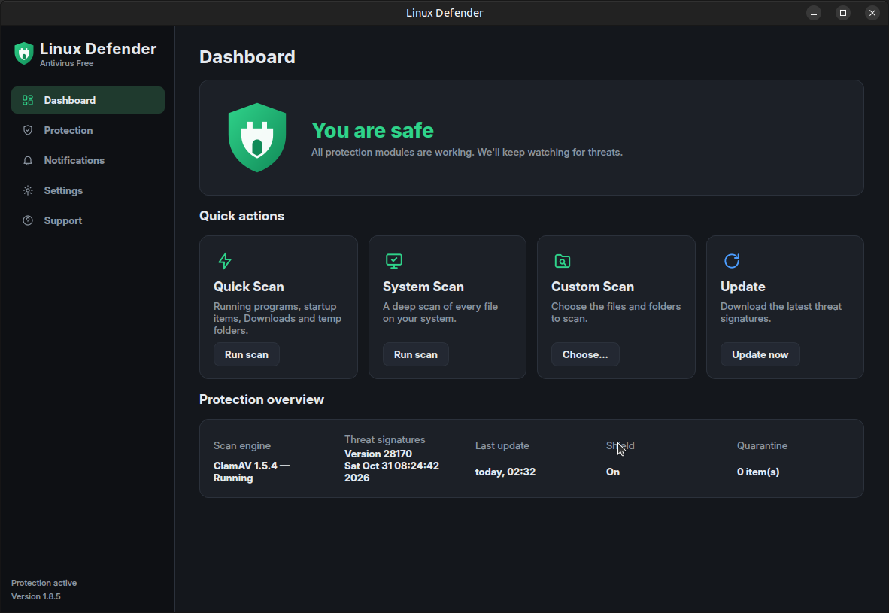

# Linux Defender 1.8.5 — free antivirus for Linux

Linux Defender is a free desktop antivirus for Linux. It's built on the **ClamAV** detection engine and a Qt 6 interface,
and ships as a single AppImage for Ubuntu 24.04 and other recent x86_64 distributions (see
[Compatibility](#compatibility)).

**Download:** the latest AppImage is on the [Releases](https://github.com/demosthenesk/Linux-Defender/releases/latest)
page.



## Features

* **Dashboard**: protection status, issues with *Fix* buttons, quick actions and a protection overview
* **Scans**: Quick Scan (running programs, autostart entries, cron jobs, Downloads, Desktop, temp folders),
  System Scan (whole system), Custom Scan, and saved custom scans. **Start, Pause, Resume and Stop** for every scan
  type (Quick, System, Custom, saved, scheduled, file-manager scans) on its row in Protection › Antivirus, on the
  Dashboard *scan in progress* card, on the scan screen and in the tray menu. A paused scan reads no more files, and
  its timer stops. You can choose an action per threat.
* **Shield**: real-time scanning of protected folders through inotify, without root
* **Threat actions**: move to quarantine, delete, or report only (the Shield then denies access)
* **Quarantine**: encrypted vault; filter and sort the list. Tick checkboxes or Ctrl/Shift-click to select several items;
  **Select all** (only the rows the filter shows) and **Select none**; clicking a row only opens it, so your ticks stay; **Restore selected** to the original locations
  or **Restore selected to…** a folder (one item can be renamed). If files already exist you choose Replace, Keep both
  (renamed copy) or Skip. You can also **Delete selected**.
  **Quarantine folder** management: see the location, item count, space used and free space; open the folder; move
  it anywhere you can write (items are copied and verified before the originals are removed; a folder that already
  holds other files gets a *Linux Defender Quarantine* subfolder) or back to the default; age limit; size limit
  (oldest items go first, and a new item is always kept); **Empty quarantine**; **Rescan** items with the current
  signatures, manually or automatically after every signature update. Items that are no longer detected (false
  positives) are flagged so you can restore them.
* **Exceptions**: files and folders that scans and the Shield skip
* **Scheduled scans**: daily or weekly Quick or System scan. The *Scheduled scan status* box shows what the schedule
  is doing. A running scheduled scan can be **paused, resumed or stopped** (it won't run again until the next
  scheduled time). A scan waiting for another scan can be skipped (**Skip this run**), and the upcoming scan can be
  skipped without turning the schedule off (**Skip next scan**, **Undo skip**).
* **Notifications**: notification centre with Critical/Warning/Information filters
* **Logs** (Protection › Logs): scan reports, scan engine and update logs in one list. Filter by type, search, and
  view a log. Tick checkboxes (or Ctrl/Shift-click) to select several; **Select all** / **Select none**; **Move
  selected to folder…**; **Delete selected**. Logs the engine or updater is using are copied and then emptied
  instead of deleted, so logging continues. Retention rules (age, maximum number of scan reports) are applied
  hourly; **Delete all logs**; open the logs folder.
  The report of a scan is created when the scan starts and is **locked while the scan is running or paused**. It is
  read-only and holds a file lock; the Logs page shows it with a padlock, it can't be ticked, moved or deleted, and
  retention and *Delete all* skip it. It is unlocked when the scan finishes or is stopped. A report left by a crashed
  session shows as *interrupted* and can be deleted.
* **One scan at a time**: starting a second scan (button, tray, file manager, command line) is refused with a message
  naming the running scan, and the refusal is logged. A scheduled scan that comes due waits until the running scan
  ends.
* **Updates**: signature updates through `freshclam`, automatic every 1–24 hours, with proxy support.
  You can **pause**, **resume** or **stop** a signature download from the Dashboard, Settings › Update, the
  first-run setup or the tray menu. A paused download is frozen in place. If the server closed the connection
  during a long pause, the download continues automatically on resume; finished database files are kept, and only
  the interrupted file is downloaded again. Stopping removes the partial files.
* **Desktop integration**: tray icon, start on login, applications-menu launcher, and *Scan with Linux Defender* in
  the right-click menu of **Caja** (MATE), Files (Nautilus), Nemo and Dolphin, for files, folders and several items at
  once. In Caja the entry is directly in the right-click menu when `caja-actions` is installed
  (`sudo apt install caja-actions`; right-click an empty area to scan the open folder), and always under
  *Scripts › Scan with Linux Defender*.
* Dark and light themes

## Run

```bash
chmod +x Linux_Defender-1.8.5-x86_64.AppImage
./Linux_Defender-1.8.5-x86_64.AppImage            # GUI
./Linux_Defender-1.8.5-x86_64.AppImage --tray     # start in the system tray
./Linux_Defender-1.8.5-x86_64.AppImage --scan ~/Downloads/file.zip
./Linux_Defender-1.8.5-x86_64.AppImage --quick-scan | --system-scan | --update
```

The AppImage contains Qt 6 (PySide6) and ClamAV 1.5 (clamd, freshclam and the ClamAV root certificate used to verify
signature databases), so ClamAV doesn't need to be installed. It runs on the system's Python (3.9 or newer; Ubuntu
24.04 ships 3.12). On the first run Linux Defender downloads about 230 MB of ClamAV
signatures from `database.clamav.net`. While the app is running, `clamd` keeps them in memory, which takes
roughly 1–1.5 GB of RAM.

AppImages need FUSE 2: `sudo apt install libfuse2t64` (Ubuntu 24.04 and later), `sudo apt install libfuse2` (Debian),
`sudo dnf install fuse-libs` (Fedora), `sudo pacman -S fuse2` (Arch).
On GNOME, the tray icon needs the *Ubuntu AppIndicators* extension (enabled by default on Ubuntu; on other
distributions install *AppIndicator and KStatusNotifierItem Support*).

## Compatibility

The AppImage is built and tested on **Ubuntu 24.04 (x86_64)**. It has two parts with different requirements:

* **Interface** (Qt 6.8 / PySide6, bundled): glibc 2.28 or newer, Python 3.9 or newer, and the usual X11 desktop
  libraries. On Wayland desktops it runs through XWayland.
* **Scan engine and updater** (ClamAV 1.5.4, bundled from Ubuntu 24.04): glibc **2.39** or newer, plus these system
  libraries: OpenSSL 3, `libxml2.so.2`, `libunistring.so.5`, `libpcre2`, `libsystemd`. This part sets the limit.

| Distribution | Status |
|---|---|
| Ubuntu 24.04 and later, its flavours (Ubuntu MATE, Kubuntu, Xubuntu, …), Linux Mint 22.x, Pop!_OS 24.04, Zorin OS 18, elementary OS 8, KDE neon | ✅ Supported (tested on Ubuntu 24.04) |
| Debian 13, Fedora 40 and later | ✅ Expected to work (not tested) |
| Arch, Manjaro, openSUSE Tumbleweed | ⚠️ The interface works; the scan engine needs `libxml2.so.2`, which newer libxml2 versions renamed (on Arch: `sudo pacman -S libxml2-legacy`) |
| Ubuntu 22.04, Linux Mint 21, Debian 12, RHEL / Rocky / AlmaLinux 9, Zorin OS 17 | ❌ The interface opens, but scanning and updates don't work (glibc older than 2.39) |
| Alpine and other musl-based distributions, 32-bit or ARM systems | ❌ Not supported |

If the scan engine can't start, the Dashboard reports it, and `~/.local/share/linux-defender/logs/clamd.stdout.log`
names the missing library. Older distributions can still use [Run from source](#run-from-source) with their own
ClamAV packages.

Data locations:

* settings — `~/.config/linux-defender/`
* signatures, quarantine (default location), logs, events — `~/.local/share/linux-defender/`
* clamd socket — `$XDG_RUNTIME_DIR/linux-defender/clamd.sock`

## Run from source

```bash
sudo apt install clamav clamav-daemon clamav-freshclam python3-pip
pip install --user PySide6-Essentials==6.8.1
python3 -m linux_defender
```

When it isn't running from the AppImage, Linux Defender uses the system `clamd` and `freshclam`, each with its own
per-user configuration. It doesn't touch `/etc/clamav`.

## Build the AppImage

```bash
packaging/build_appimage.sh        # output: dist/Linux_Defender-<version>-x86_64.AppImage
```

## Source layout

```
linux_defender/
  app.py           entry point, CLI, single instance
  controller.py    service glue + Qt signals, schedule, status/issues
  engine.py        per-user clamd daemon + socket client
  scanner.py       quick/system/custom scan jobs
  shield.py        inotify real-time protection
  quarantine.py    encrypted quarantine vault
  updater.py       freshclam runner with progress
  events.py        notification store
  logs.py          log listing, move, delete, retention
  integration.py   autostart, applications menu, file-manager actions
  ui/              Qt Widgets UI: main window, pages, theme, icons
packaging/         AppRun, launcher, desktop file, icon, build script
docs/screenshots/  screenshots used in this README
tests/             headless UI tests (screenshots, switch layout, switch states, notifications, every button, download controls, quarantine, scan controls, quarantine selection, logs, scan lock, scheduled scans, checkbox layout, field widths, ClamAV certificate, Caja integration, single instance)
```

## Changes

* **1.8.5** — *Scan with Linux Defender* for Caja (MATE): in the right-click menu (with caja-actions) and under
  Scripts, for files, folders, several items, or the open folder. Fixed the Files (Nautilus) script, which split
  names containing spaces. Fixed: a scan started from a file manager, the tray or a launcher opened a second copy of
  Linux Defender (which took over the scan engine) instead of handing the files to the running one; since 1.6.0 the
  app's single-instance socket clashed with a folder of the same name. A scan request that arrives while the engine
  is still starting now waits for it.
* **1.8.3** — Fixed: on a system without ClamAV installed, *Download* failed with "Invalid certs directory
  '/etc/clamav/certs/'", and the scan engine couldn't load signatures. ClamAV 1.5 needs its root certificate to verify
  signature databases; the AppImage now ships it and points freshclam and clamd to it.
* **1.8.2** — Fixed: the scheduled-scan *Time* field was too narrow and hid part of the time ("12:0"); the same
  happened to *Ignore files larger than*. Every number and time field is now sized for its longest value, is as tall
  as the other inputs, and has visible up/down arrows. Drop-down arrows have a matching, clean style.
* **1.8.1** — Fixed: in the Logs and Quarantine lists the checkbox was drawn over the start of the first column
  (e.g. "today" showed as "oday"). Checkboxes now have their own column.
* **1.8.0** — Scheduled scans: status box with Pause / Resume / Stop for a running scheduled scan, Skip this run for
  a waiting one, Skip next scan / Undo skip for the upcoming one. Changing the schedule clears a skip.
* **1.7.0** — Scan reports are locked while their scan runs or is paused, and unlocked when it finishes or is
  stopped. One scan at a time, enforced atomically for every entry point, with an explanatory message.
* **1.6.0** — Logs manager: list, filter, view, multi-select, Select all / none, move selected to a folder, delete
  selected, retention rules, delete all. Ticks are now the selection in Logs and Quarantine, so clicking a row to view
  it keeps your ticks. A scan engine left over from a crashed session is replaced at startup.
* **1.5.0** — Scan controls (Start / Pause / Resume / Stop) for every scan type and everywhere a scan is shown; paused
  time is excluded from the scan timer and a paused scan stops walking the disk. Quarantine multi-select with
  checkboxes, Select all / none, restore or delete the selection, restore to a folder, and conflict handling.
* **1.4.0** — Quarantine folder management: location, usage, move/reset, open, size and age limits (also applied
  hourly), Empty quarantine, Rescan (manual and after signature updates) with false-positive detection, list filter
  and sorting.
* **1.3.0** — Signature download controls: Download, Pause, Resume and Stop, with live progress, on the Dashboard,
  in Settings › Update, in the first-run setup and in the tray menu. Stopping a download is logged as "stopped", not
  as a failure.
* **1.2.3** — Dashboard quick actions: the tile and its button now behave as one unit. When a scan can't start yet,
  both are disabled and the tile shows why. Fixed the *Run scan* / *Choose…* buttons on Protection › Antivirus › Scans
  and the Dashboard *Fix* buttons, which did nothing because of an argument bug in the button helper. Scan buttons
  explain why they're unavailable.
* **1.2.2** — Notifications: unread items get a blue dot, a bold title and a NEW tag. Opening an item marks it as
  read, and *Mark all as read* now works and is disabled when nothing is unread. The page no longer silently marks
  everything as read when opened. Shield notifications include details.
* **1.2.1** — Every on/off switch now shows a status line that follows its real state. The Shield line says
  whether protection is active, waiting for signatures, or turned off. Fixed overlapping scan-engine restarts when
  several Advanced options changed quickly. Turning on a schedule no longer starts a scan immediately. The Shield
  restarts cleanly after a quick off/on. Socket path fallback for long runtime directories.
* **1.2.0** — The About page now lists only Linux Defender's own components (ClamAV engine and signatures, Qt, PySide6,
  Python, operating system). Removed all references to other products.
* **1.1.1** — Fixed on/off switches jumping over their label text when clicked.
* **1.0.0** — First release.

## Licence

Linux Defender: GPL-2.0-or-later. Bundled software: ClamAV (GPL-2.0), Qt 6 / PySide6 (LGPL-3.0).
